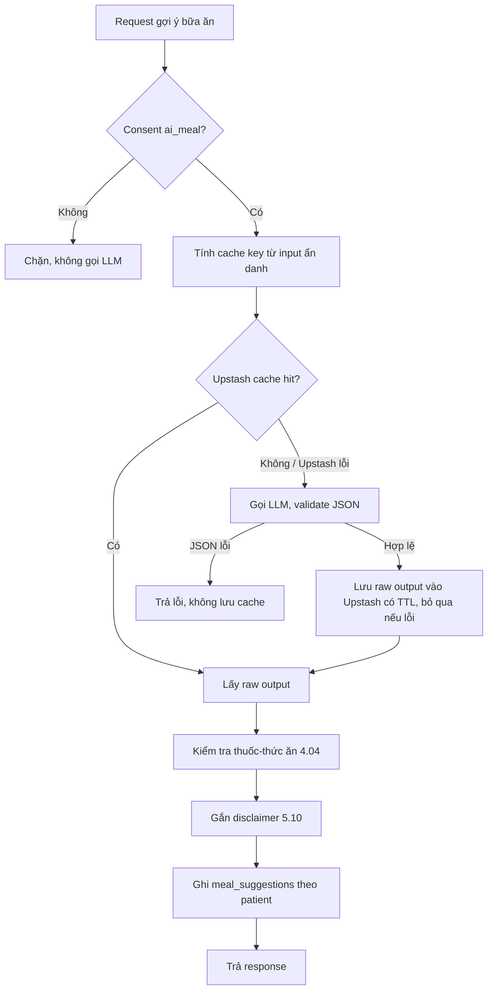

# DrugTime – Bổ sung kiến trúc: Job Queue (RabbitMQ/CloudAMQP) + LLM Cache (Redis/Upstash)

Sep 27, 2026 · @Nguyen · v4.1 — quyết định chốt của team (đồng bộ với C4 v1.1: 8 container, CD11, lịch tick/heartbeat)

## 1. Bối cảnh và phạm vi

Tài liệu này bổ sung hai quyết định kiến trúc, **CD9** và **CD10**, vào bộ CD1–CD8 và kết quả ATAM hiện có. Cả hai phát sinh từ góp ý review của senior. Bản này **thay thế kết luận của bản nháp ngày 26/9** (giữ Redis làm job queue): team chốt chuyển job queue sang RabbitMQ managed và đặt cache trên một Redis managed riêng.

Căn cứ: Project Proposal v4.2 (§8.1, §10, §12, §13, References), Quyết định kiến trúc CD1–CD8 và ATAM, Schema CSDL v8, Sprint Backlog (1.18, 1.19, 3.19, 4.04, 4.13–4.16, 5.08–5.12, 6.01, 6.20).

| # | Góp ý của senior | Kết luận |
| --- | --- | --- |
| 1 | Redis chủ yếu dùng để cache; làm message queue là không hợp lý, nên dùng RabbitMQ hoặc Kafka. | Chấp nhận. Job queue chuyển sang RabbitMQ managed trên CloudAMQP, thư viện job đổi từ RQ sang Celery (CD9). Không dùng Kafka, không tự host. |
| 2 | Meal suggestion gọi LLM liên tục sẽ đội chi phí, cần cơ chế cache. | Chấp nhận. Cache LLM output trên Redis managed của Upstash, tách khỏi broker (CD10). |

Kết quả: Render Key Value bị bỏ. Broker (CloudAMQP) và cache (Upstash) là hai dịch vụ riêng, mỗi dịch vụ một vai trò. Postgres vẫn là nguồn chân lý duy nhất cho dữ liệu nghiệp vụ.

## 2. CD9 – RabbitMQ (CloudAMQP) làm broker, Celery làm task queue

| **CD9 – Broker job queue dùng RabbitMQ managed (FR07, FR08, QA.07)** | |
| --- | --- |
| **Tactic / pattern** | Tactic: Use managed services, Retry với idempotent receiver, State Resynchronization. Pattern: Task queue (Celery) trên message broker (RabbitMQ); cơ sở dữ liệu là nguồn chân lý (kế thừa CD6). |
| **Mô tả** | Background Job Worker chạy Celery, dùng RabbitMQ trên CloudAMQP làm broker cho ba loại job: phát hiện bỏ lỡ liều (CD6), đồng bộ danh mục (FR08) và xóa dữ liệu (5.08). Queue durable, message persistent, task dùng `acks_late` nên job chỉ bị xóa khỏi queue sau khi chạy xong; Worker chết giữa chừng thì job được giao lại, và job idempotent nên chạy lại không tạo dữ liệu trùng. Lịch định kỳ khai báo trong code bằng Celery Beat, chạy nhúng trong tiến trình Worker duy nhất (`worker -B`), nên không cần thêm service và lịch không phụ thuộc trạng thái lưu trong broker. Message chỉ mang ID (ví dụ `data_deletion_request_id`), không mang dữ liệu sức khỏe. Không dùng result backend. Mỗi loại job vẫn khôi phục được từ Postgres: job định kỳ tự bù ở lần chạy kế tiếp; job xóa dữ liệu được một lần quét định kỳ đẩy lại cho mọi yêu cầu đã duyệt mà chưa `hoan_tat`. |
| **Phương án đã cân nhắc** | (1) Giữ Redis (Render Key Value) làm broker với RQ: ít thay đổi nhất, nhưng free Key Value không có persistence nên mất job khi restart, và dùng chung với cache gây tranh bộ nhớ. (2) Kafka: thiết kế cho event streaming throughput cao, quá mức cần thiết với job định kỳ tần suất thấp. (3) RabbitMQ tự host trên VPS Oracle Always Free: không tốn tiền nhưng thêm máy chủ tự quản (patch OS, TLS, firewall, giám sát) và thêm bề mặt tấn công khi xử lý dữ liệu sức khỏe (NFR01). |
| **Rủi ro và giảm thiểu** | (1) Gói free Little Lemur là vhost trên server dùng chung, không SLA, có giới hạn số message mỗi tháng, số message đang chờ, số queue và số kết nối; vượt giới hạn thì bị chặn publish. Giảm thiểu: tắt các tính năng Celery tạo message phụ (events, gossip, mingle, remote control), theo dõi usage trên console CloudAMQP, và mọi job khôi phục được từ DB. (2) Kết nối Render → CloudAMQP đi qua Internet công cộng. Giảm thiểu: chỉ dùng `amqps://` (TLS), đặt instance cùng region gần nhất với Render. (3) CloudAMQP là bên xử lý dữ liệu mới. Giảm thiểu: message chỉ chứa ID, đưa CloudAMQP vào DPIA (1.19, 6.01) và đánh giá chuyển dữ liệu xuyên biên giới (R-04). (4) Job dài (đồng bộ danh mục) có thể vượt consumer timeout của RabbitMQ khi dùng `acks_late`, gây giao lại. Giảm thiểu: chia job đồng bộ thành các lô nhỏ, mỗi lô là một task. |
| **Đánh đổi** | Thêm một nhà cung cấp và phải đổi thư viện job (RQ → Celery), đổi lấy delivery guarantee mạnh hơn (durable queue, ack), lịch nằm trong code, và broker tách hẳn khỏi cache. Gói free không có SLA nên QA.07 vẫn dựa vào khả năng khôi phục từ DB (CD4, CD6). |

## 3. CD10 – Cache LLM output trên Upstash (mới)

| **CD10 – Cache kết quả LLM theo input đã ẩn danh (FR05, R-07, NFR01)** | |
| --- | --- |
| **Tactic / pattern** | Tactic: Maintain Multiple Copies of Data (caching), Reduce Computational Overhead. Pattern: Cache-aside trước LLM Provider; kiểm tra an toàn luôn chạy lại khi phục vụ. |
| **Mô tả** | Trước khi gọi LLM, module `ai_meal` tính cache key từ input đã tối thiểu hóa theo 5.09 và tra Redis trên Upstash. Cache hit thì dùng lại output đã lưu; cache miss thì gọi LLM, và chỉ output đã qua validate JSON mới được lưu, kèm TTL. Chỉ cache raw LLM output; kiểm tra thuốc–thức ăn rule-based (4.04) và gắn disclaimer (5.10) luôn chạy lại mỗi lần phục vụ. Cache lỗi thì bỏ qua cache và gọi thẳng LLM (fail-open). |
| **Cache key** | `meal_cache:` + hash(sorted(hoạt chất đang dùng) + sorted(tình trạng bệnh) + sorted(thực phẩm cần tránh) + phiên bản prompt). Không chứa `user_id` hay dữ liệu định danh. Hai patient cùng tổ hợp dùng chung một entry; đổi thuốc, bệnh lý, hoặc danh mục làm đổi danh sách thực phẩm cần tránh thì key đổi, entry cũ tự hết hiệu lực. Nếu gợi ý phân biệt bữa sáng/trưa/tối thì phải thêm loại bữa vào key. |
| **Biến thể (N)** | Mỗi key lưu tối đa N gợi ý; khi phục vụ chọn ngẫu nhiên hoặc xoay vòng. N=1: tiết kiệm tối đa, mọi lần trả y hệt nhau. N>1: đa dạng hơn nhưng tốn N lần gọi LLM ban đầu mỗi key. Đề xuất MVP: N=1–2. |
| **Rủi ro và giảm thiểu** | (1) Catalogue `drug_food_interactions` cập nhật sau khi đã cache, món cũ nay xung đột. Giảm thiểu: không cache kết quả kiểm tra, luôn chạy lại 4.04 lúc phục vụ. (2) Gợi ý lặp lại gây nhàm. Giảm thiểu: N biến thể, TTL hữu hạn. (3) Hit rate thấp khi ít người dùng (giai đoạn demo). Giảm thiểu: đo hit rate thật thay vì giả định. (4) Đổi prompt làm output cũ không còn đúng định dạng. Giảm thiểu: phiên bản prompt nằm trong key. (5) Hết quota command hoặc dung lượng của gói free Upstash. Giảm thiểu: mỗi request chỉ tốn khoảng một lệnh đọc và tối đa một lệnh ghi, TTL bắt buộc, fail-open khi Upstash từ chối lệnh. |
| **Đánh đổi** | Giảm chi phí và độ trễ gọi LLM ↔ độ đa dạng và độ mới của gợi ý. Rút consent `ai_meal` vẫn chặn API trước khi tra cache, nên cache không vượt qua kiểm soát consent. Cache nằm ở nhà cung cấp riêng nên không tranh bộ nhớ với job queue. |

Mức giảm chi phí phụ thuộc hit rate: chi phí LLM ≈ (số request × (1 − hit rate)) × giá mỗi lần gọi, cộng chi phí lấp N biến thể cho mỗi key mới.

## 4. Luồng xử lý meal suggestion

Cache quyết định có cần gọi LLM hay không; bảng `meal_suggestions` ghi lại patient nào đã nhận gợi ý gì. Hai việc độc lập, không thay thế nhau.

| Tiêu chí | Cache (Upstash) | `meal_suggestions` (Postgres) |
| --- | --- | --- |
| Mục đích | Giảm số lần gọi LLM | Lịch sử cho UI, audit (NFR05), xóa dữ liệu (5.08) |
| Gắn với | Tổ hợp thuốc + bệnh lý (ẩn danh) | `user_id` cụ thể |
| Thời gian sống | TTL, có thể bị evict | Đến khi patient yêu cầu xóa |
| Mất dữ liệu | Chấp nhận được (gọi lại LLM) | Không chấp nhận được |
| Nội dung | Raw LLM output đã validate | Gợi ý đã qua kiểm tra, đã phục vụ |

Cache không chứa định danh nên không nằm trong phạm vi job xóa dữ liệu 5.08.

## 5. Vận hành

| Hạng mục | Quy ước |
| --- | --- |
| Kết nối | CloudAMQP qua `amqps://`, Upstash qua `rediss://` (TLS). Cả hai đặt ở region gần nhất với Render service. URL lưu trong secret của Render, không nằm trong repo. |
| Celery trên gói free | Không result backend; tắt task events, gossip, mingle và remote control; broker pool nhỏ; `acks_late` cho các task idempotent; một tiến trình Worker duy nhất chạy Beat nhúng (`-B`), đúng với giả định "chỉ một Worker chạy job này" của CD6. |
| Lịch định kỳ | Khai báo trong code (Celery Beat): `tick` mỗi 5 phút (missed-dose, `sync_if_due`, `resume_erasures`) và `heartbeat` mỗi phút (C4 v1.1, DW0). File trạng thái của Beat trên Render là tạm thời, mất khi deploy lại; chấp nhận được vì job idempotent và lần chạy kế tiếp tự bù. |
| Cache | Mọi key có TTL. Bật eviction của database Upstash nếu gói free hỗ trợ, như lớp bảo vệ thứ hai sau TTL. |
| `/health` | Readiness phụ thuộc DB và RabbitMQ; Upstash được báo trạng thái nhưng không làm readiness thất bại, vì cache fail-open. |
| Giám sát | Usage message/kết nối trên console CloudAMQP; command và dung lượng trên console Upstash; cảnh báo khi đạt 80% hạn mức tháng. |

Giới hạn cụ thể của gói free cần xác nhận trên trang giá chính thức trước khi chốt ở 4.16: CloudAMQP Little Lemur (cloudamqp.com/plans) có giới hạn message/tháng, message đang chờ, queue và kết nối; Upstash free theo trang giá của Upstash là 256 MB và 500.000 command/tháng. CloudAMQP cũng xóa queue không có consumer trong thời gian dài trên gói shared, không ảnh hưởng khi Worker chạy liên tục.

## 6. Sửa đổi cần áp vào tài liệu hiện có

### Proposal v4.2 (viết bằng tiếng Anh, theo ngôn ngữ của Proposal)

**§8.1 – Constraint "Economic & Environmental"** (cần mentor/PO xác nhận vì Render Background Worker không có gói Free)
- Trước: `Run MVP on a near-zero budget using Render's free-tier services.`
- Sau: `Run MVP on a near-zero budget using free tiers (Render, CloudAMQP, Upstash); paid plans only where no free tier exists (Render Background Worker).`

**§10 – Technology Stack**
- Trước: `Background jobs: RQ with Redis`
- Sau: `Background jobs: Celery with RabbitMQ (CloudAMQP)`
- Trước: `AI meal suggestion: LLM-based, using only the minimal context permitted.`
- Sau: `AI meal suggestion: LLM-based, using only the minimal context permitted; responses are cached in Redis (Upstash) by de-identified input to reduce LLM cost.`

**§12.1 – Container/Component View**
- Trước: `The system has six main containers:` — Sau: `The system has eight main containers:` (thêm Mobile Local Store theo C4 v1.1, và Redis tách thành RabbitMQ + Redis Cache)
- Thêm dòng: `Mobile Local Store: SQLite + SQLCipher on device - Encrypted per-user copy of schedules and the dose-confirmation outbox.`
- Trước: `Background Job Worker: RQ + Redis - Detects missed doses and sends FCM alerts; synchronizes catalogues`
- Sau: `Background Job Worker: Celery - Detects missed doses and sends FCM alerts; synchronizes catalogues; executes approved data deletions.`
- Trước: `Redis (Render Key Value): Job queue backing the Background Job Worker.`
- Sau (hai dòng):
  - `RabbitMQ (CloudAMQP): Message broker for the Background Job Worker.`
  - `Redis (Upstash): Cache for LLM meal-suggestion output.`

**§12.2 – Architecture Style**
- Trước: `...asynchronous jobs (RQ) handle deferred work.`
- Sau: `...asynchronous jobs (Celery) handle deferred work.`

**§12.3 – Deployment View**
- Trước: `The Backend API runs as a Render Web Service, the Job Worker as a Render Background Worker, with Redis as a Render Key Value instance; the database is a managed Supabase instance.`
- Sau: `The Backend API runs as a Render Web Service and the Job Worker as a Render Background Worker (Celery worker with an embedded Beat scheduler). RabbitMQ runs as a managed CloudAMQP instance and the meal-suggestion cache as a managed Upstash Redis database; the database is a managed Supabase instance.` (câu cuối về chi phí giữ nguyên)

**§13 – Risk register**
- R-03, cột Risk — Trước: `Free-tier limits are reached during the demo.` — Sau: `Free-tier limits (Render, CloudAMQP, Upstash, LLM provider) are reached during the demo.`
- R-03, cột Mitigation — Sau: `Usage is monitored on each provider's console; on-device scanning has no cloud quota, manual input stays available, and cached meal suggestions reduce LLM calls.`
- Thêm dòng:
  > | R-09 | CloudAMQP or Upstash (shared free plans, no SLA) is unavailable or blocks requests after reaching a quota. | Medium | Low | All job state is recoverable from PostgreSQL; the cache fails open to a direct LLM call; Celery auxiliary messaging is disabled to stay within quota. |

**References**
- Trước: `[15]. RQ, RQ (Redis Queue) Documentation. https://python-rq.org/ (accessed September 2026).`
- Sau: `[15]. Celery Project, Celery Documentation. https://docs.celeryq.dev/ (accessed September 2026).`
- Thêm: `[17]. 84codes, CloudAMQP Documentation. https://www.cloudamqp.com/docs/ (accessed September 2026).` và `[18]. Upstash, Upstash Redis Documentation. https://upstash.com/docs/redis (accessed September 2026).`

### Quyết định kiến trúc và ATAM

- Tiêu đề: `(CD1–CD8)` → `(CD1–CD11)`; chèn CD9, CD10 như mục 2–3, và CD11 (xóa dữ liệu idempotent) theo tài liệu C4 v1.1.
- Dòng Phạm vi — Trước: `(Mobile App, Backend API, Background Job Worker, Redis, Database, Admin Web)` — Sau: `(Mobile App, Backend API, Background Job Worker, RabbitMQ, Redis cache, Database, Admin Web)`.
- CD4, Mô tả — Trước: `readiness (cơ sở dữ liệu, Redis, heartbeat của Worker)` — Sau: `readiness (cơ sở dữ liệu, RabbitMQ, heartbeat của Worker; Redis cache chỉ báo trạng thái, không làm readiness thất bại)`.
- CD6, rủi ro (3) — Trước: `Hàng đợi job được coi là không bền vững và có thể mất job khi broker khởi động lại.` — Sau: `Không dựa vào độ bền của hàng đợi job, dù RabbitMQ dùng queue durable; job vẫn có thể mất nếu broker gặp sự cố hoặc chặn publish do hết quota.` (phần giảm thiểu giữ nguyên).
- CD8, rủi ro (2): giữ nguyên; nếu module `ai_meal` tạo port cho LLM thì cache đặt như decorator quanh port đó.
- Sensitivity points — thêm **SP5:** TTL và số biến thể N của cache (chi phí LLM ↔ độ đa dạng gợi ý).
- Trade-off points — thêm **TP8:** Chi phí LLM ↔ độ mới và độ đa dạng gợi ý (CD10). Thêm **TP9:** Delivery guarantee của broker chuyên dụng ↔ thêm nhà cung cấp bên ngoài và phạm vi DPIA (CD9).
- Risks — thêm **R9** (tương ứng R-09 ở Proposal): CloudAMQP và Upstash là gói free dùng chung, không SLA, có quota; là hai bên xử lý dữ liệu mới cần có trong DPIA.
- Non-risks — thêm: kiểm tra an toàn (4.04) luôn chạy lại khi phục vụ, nên cache không làm gợi ý bỏ qua cập nhật danh mục; broker và cache tách riêng nên không tranh bộ nhớ.
- Mục 3 "Thay đổi cần thực hiện ở tài liệu khác": thêm các mục Proposal, Schema và Backlog của tài liệu này.

### Schema v8

- `meal_suggestions`: thêm `created_at` (thời điểm phục vụ) và `served_from_cache` (boolean) để đo hit rate và phục vụ audit. Không lưu cache key trong bảng này.

### Sprint Backlog

- **1.18** — Tiêu đề: `Build RQ scheduled sync job` → `Build Celery scheduled sync job`. "Viết job RQ" → "Viết task Celery"; "rq-scheduler hoặc cron" → "Celery Beat"; chia đồng bộ thành các lô nhỏ.
- **1.19** và **6.01** (DPIA): thêm CloudAMQP (payload job, chỉ chứa ID) và Upstash (cache, không định danh) vào danh sách luồng dữ liệu, kèm region.
- **3.19**: "Job RQ chạy định kỳ" → "Task Celery chạy định kỳ qua Celery Beat".
- **4.13**: `/health` kiểm tra DB và RabbitMQ; Upstash chỉ báo trạng thái.
- **4.14**: "Redis URL" → "CloudAMQP URL (`amqps://`), Upstash URL (`rediss://`)".
- **4.15** — viết lại:
  - Tiêu đề: `Run Celery worker on Render with CloudAMQP broker; set up Upstash cache`.
  - Cần làm: tạo instance CloudAMQP (Little Lemur) và database Upstash cùng region gần Render; tạo Background Worker chạy `celery worker -B` với cấu hình ở mục 5; kiểm tra chi phí Worker trên Render.
  - Tiêu chí: hai job định kỳ chạy đúng lịch; Worker khởi động lại vẫn chạy đúng lịch (lịch nằm trong code); dừng Worker giữa job thì job được giao lại và không tạo dữ liệu trùng.
- **4.16**: bổ sung đo độ trễ Render → CloudAMQP và Render → Upstash; xác nhận giới hạn gói free của cả hai trên trang giá chính thức.
- **5.08**: "đẩy job RQ" → "đẩy task Celery"; thêm quét định kỳ đẩy lại yêu cầu đã duyệt mà chưa `hoan_tat`; tiêu chí bổ sung "broker mất message, yêu cầu xóa vẫn được hoàn tất".
- **5.09**: thêm bước tra/ghi cache Upstash, phiên bản prompt trong key, chỉ cache output đã validate; tiêu chí bổ sung "cache hit không gọi LLM", "rút consent `ai_meal` chặn trước khi tra cache", "Upstash không kết nối được vẫn trả gợi ý".
- **5.12**: thêm test cache hit/miss, test catalogue đổi sau khi đã cache vẫn bắt được xung đột, test JSON lỗi không vào cache, và log hit rate.
- **6.20**: runbook thêm CloudAMQP và Upstash (biến môi trường, xoay vòng credential, nơi xem usage).

## 7. Việc team cần chốt và điều kiện xem xét lại

### Tham số cần chốt

- [ ] Region của Render service, CloudAMQP và Upstash (chọn gần nhau; đầu vào cho DPIA).
- [ ] Giới hạn chính xác của gói free CloudAMQP Little Lemur và Upstash, theo trang giá chính thức.
- [ ] TTL của cache (đề xuất bắt đầu 7 ngày) và số biến thể N (đề xuất 1–2).
- [ ] Có đưa loại bữa (sáng/trưa/tối) vào input và cache key hay không.
- [ ] Giá mỗi lần gọi của LLM Provider (5.09), để quy đổi hit rate ra số tiền tiết kiệm.
- [ ] Chi phí Background Worker trên Render so với §8.1 — mentor/PO xác nhận.

### Điều kiện xem xét lại CD9

- Usage chạm giới hạn gói free CloudAMQP thường xuyên → nâng gói hoặc xem xét lại broker.
- Cần nhiều hơn một Worker → tách Celery Beat thành tiến trình riêng để tránh chạy lịch trùng.

### Điều kiện xem xét lại CD10

- Hit rate đo được quá thấp để bù chi phí vận hành cache.
- Người dùng phản hồi gợi ý lặp lại → tăng N hoặc giảm TTL.
- Chạm quota Upstash thường xuyên → nâng gói hoặc giảm TTL.
